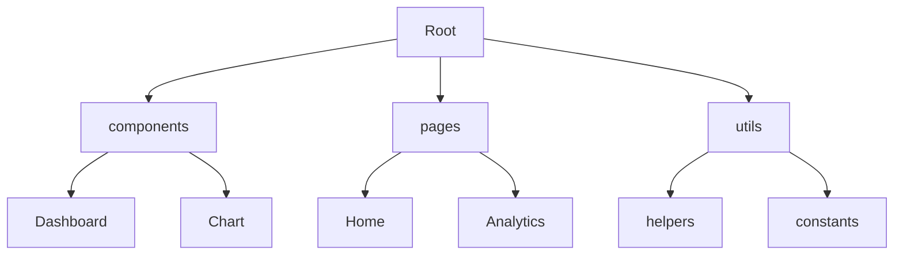

# Gemini Analysis Dashboard

## Features
- Real-time data visualization
- Interactive analytics dashboard
- Integration with Gemini AI models
- Support for multiple data sources
- Customizable graph configurations

## Installation
To install the project dependencies:
```bash
npm install
```

To start the development server:
```bash
npm run dev
```

## Tech Stack
- React
- TypeScript
- Vite
- Vitest
- Mermaid.js

## Project Structure
